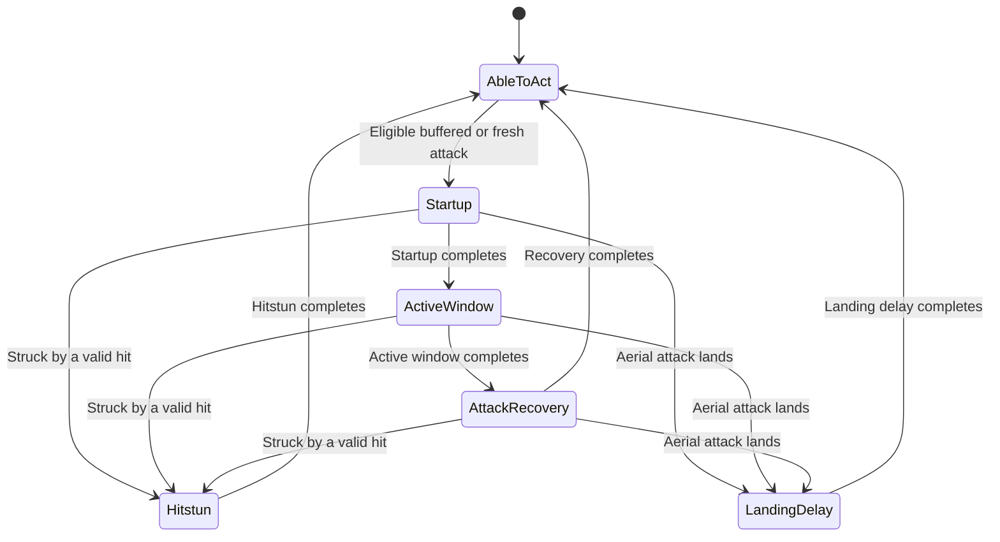
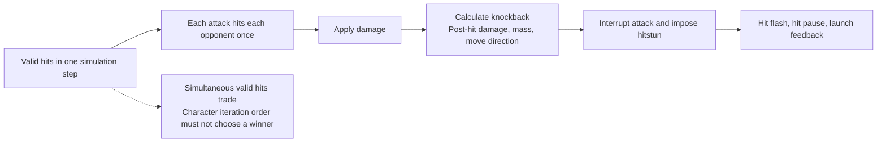

# Combat lifecycle

**Status: agreed gameplay relationships; GodotPhysics2D snapshot/batched-hit baseline accepted in #8, detailed production schedule under review.** Source: [#2](https://github.com/Fusion2k/smash-fight/issues/2), with the down-input interactions specified in [#4](https://github.com/Fusion2k/smash-fight/issues/4). The [#11 experiment](combat-timing-evidence.md) supplies timing/collision evidence and the user's positive reaction. The [module-interface draft](module-interfaces.md) records the accepted baseline and proposed detailed step order.

## Attack phases

This view omits the orthogonal airborne-resource restrictions for readability. Completing attack recovery does not restore a spent air jump or recovery special. After a recovery special, steering is allowed but jumping/attacking remains unavailable until landing or being hit; taking a hit does not replenish either resource. The involved characters' action timers freeze during hit pause.

## Hit-result constraints

Arrows express rule dependencies. They do not prescribe Godot callback order, querying before/after movement, a collision-node type, or a synchronization strategy. Ring-out decisions must likewise consider all players for the simulation step before producing a result.

During #8 the user clarified future four-player behavior: hits at distinct contact times apply sequentially, each adding damage and changing launch direction. Only a true simultaneous contact adds the incoming damage together and sums knockback vectors. Equal opposing horizontal contributions cancel, while upward contributions add. Being detected within the same simulation step does not by itself make hits simultaneous. Mutual attacks against different targets still trade when their contact times tie. The [module-interface draft](module-interfaces.md#chronological-hits-and-true-ties) records the rule and the required contact-time extension beyond #11's boolean sweeps. This clarification does not claim four-player implementation or verification.

## Timing baseline and evidence needed

The provisional baseline is 60 simulation steps per second, with a six-step input buffer, five-step ground-jump grace period, three-step hit pause, and six-step aerial landing delay. These are playtest starting values; the canonical values and exceptions live in #2.

The completed #11 experiment compares plausible approaches where their observed behavior differs, covering one-step active windows, fast movement, activation/deactivation relative to physics, repeated overlaps, multiple targets, and simultaneous hits. Its [measured results and limitations](combat-timing-evidence.md) identify a relative-translation shape-snapshot candidate and batched hit resolution. Eleven scenarios were measured and the user reported "prototype looks good"; these are not complete-match acceptance checks.

[Backend research #12](https://github.com/Fusion2k/smash-fight/issues/12) recommends the built-in backend as an initial baseline, with Rapier v0.36.1 retained as an alternative. The [source evaluation](https://github.com/Fusion2k/smash-fight/blob/1fb7589/docs/research/physics-backend-evaluation.md) identifies Rapier's backend-specific query refresh as a separate experiment if freshness matters; it does not establish an immediate Area-overlap refresh or solve per-attack hit history and simultaneous trades. The user accepted GodotPhysics2D and the snapshot/batched-hit baseline in #8 on 2026-11-15; detailed ordering and integration coverage remain under review. Box2D is deferred by the user.
