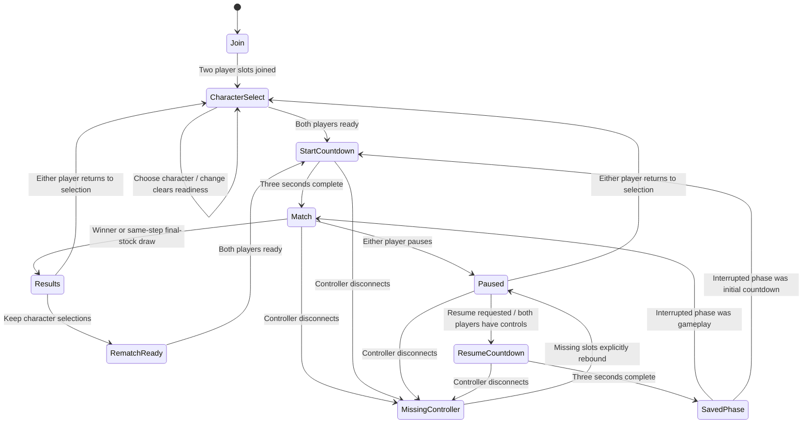
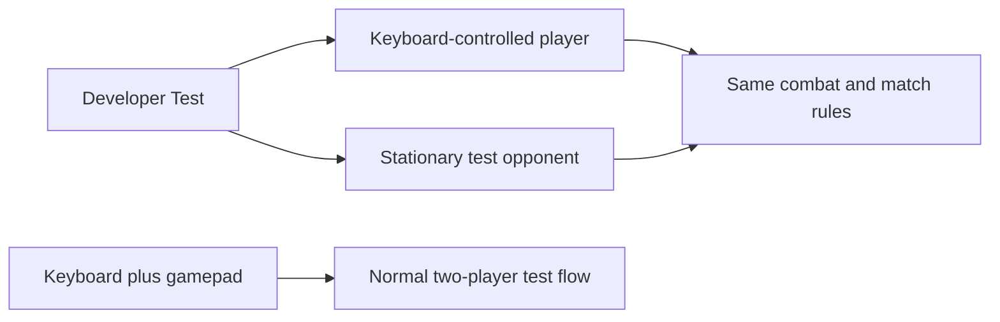

# Match flow

**Status: agreed behavior, not implemented.** Sources: [match and stock rules, #2](https://github.com/Fusion2k/smash-fight/issues/2) and [controller ownership and match flow, #4](https://github.com/Fusion2k/smash-fight/issues/4). Diagram states describe observable flow, not a prescribed state-machine class or Godot node layout.

`SavedPhase` expresses preserving the interrupted flow; it is not a new required screen. Returning to an interrupted countdown must preserve that phase rather than silently starting gameplay. Exact internal representation belongs to [#8](https://github.com/Fusion2k/smash-fight/issues/8).

## Flow invariants

- One controller belongs to one player slot. Pressing Start on another controller cannot steal a connected player's slot.
- Controller loss preserves the player's identity, selected character, and match state. An unassigned controller explicitly reclaims a missing slot; reconnection does not resume play automatically.
- Pause freezes gameplay timers, including respawn and invulnerability. Resume clears buffered actions and uses a three-second countdown.
- Each player owns their selection and readiness. Both can choose the same character, with independent mutable state and distinct player markers.
- Results follow evaluation of all ring-outs in the simulation step. Both final stocks lost in that step produce a draw.

## Developer entry

The stationary opponent is a developer convenience, not an AI-opponent feature. Shared-keyboard multiplayer remains deferred. Controller compatibility and Steam Deck/TV presentation still need physical verification under [#10](https://github.com/Fusion2k/smash-fight/issues/10).
