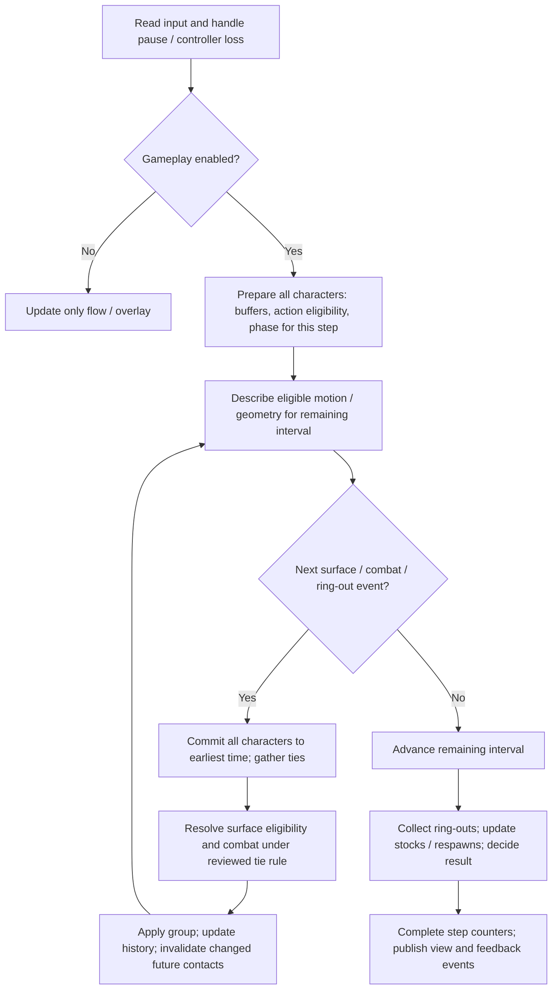

# Module interfaces

**Status: design draft for [#8](https://github.com/Fusion2k/smash-fight/issues/8), not implemented.** Accepted choices: GDScript, GodotPhysics2D with the #11 shape-snapshot baseline, the ownership split below, custom Resources with an Inspector JSON picker, simulation-owned attack timing, per-character hit pause with frozen input-buffer expiry, and fixed rectangular combat shapes. Distinct contact times resolve sequentially; true simultaneous contacts add damage and sum knockback vectors. The concrete interfaces and production schedule below await final shared-understanding review. #13 is resolved with the new human reaction, "looks ok, keep going", on 2026-11-15; its scoped evidence supports this design, while integrated native behavior still requires implementation and acceptance checks. Proposed paths describe the intended implementation; they do not exist yet.

## Ownership and interfaces

| Module / proposed path | Owns and hides | Interface and invariants |
| --- | --- | --- |
| Application flow / `app/app.gd` | Active view, player slots, selections/readiness, controller assignment and replacement | Join/select/ready/pause/resume commands; supplies a match setup containing slot IDs and chosen character definitions. Controller IDs never become character identity. |
| Input / `input/player_input.gd` | Device-specific reads, analog thresholds, fresh-down detection | Produces one input frame per slot: horizontal amount, attack direction, held jump and fresh action presses. Gamepad, keyboard and stationary opponent produce this same shape. No combat rules here. |
| Character catalog / `characters/character_catalog.gd` | JSON reading, schema and editor-content validation, useful aggregated diagnostics | `prepare_match(definitions)` returns fresh validated settings or file/field diagnostics. Invalid selections cannot start. Retry rereads JSON; a running match retains its prepared settings. |
| Match / `match/match.gd` | Character composition, stocks, respawn scheduling, explicit simulation order, pause gate and final result | `start(setup)`, `step(input_frames)`, `set_paused(value)`, `clear_inputs()`; publishes a read-only view and events for presentation. Owns the only gameplay physics callback. |
| Character / `characters/character.gd` | Independent velocity, damage, action phase, hitstun, hit pause, airborne resources, input buffer and per-attack target history | `prepare_step(input)`, `predict_interval(until)`, `commit_interval(plan, until)`, `apply_event_group(results)`, `finish_step()`, `respawn(position)`. Prediction returns motion/geometry and the next native surface event without changing state; commit advances only the agreed prefix. Plans carry a state revision and become invalid after state changes. Match coordinates interval advancement; preparation/finalization occur once per whole step. No autonomous physics callback. Integrated prediction/commit equivalence must be verified through this interface. |
| Hit detection / `combat/hit_detection.gd` | Relative-translation shape checks, contact times, eligibility and once-per-target filtering | Proposed `next_contacts(motion_segments)` returns the earliest contact-time group without mutating characters. Explicit native shapes replace assumptions about Area polling freshness. #11 verifies collision booleans, not this contact-time extension. |
| Hit resolution / `combat/hit_resolution.gd` | Chronological damage, knockback, hitstun and trade calculations | Proposed `resolve(contact_group, before_contact_state)` returns per-character results/events for one contact time. Simultaneous incoming hits add damage and sum launch vectors; distinct times resolve in order. All results within a true tie are calculated before interruption. Formula coefficients remain provisional shared rules. |
| Arena / `arenas/first_arena.tscn` | Solid surfaces, one-way platforms, start/respawn markers, ring-out limits and fixed camera | Exposes markers and `is_out(position)` to Match. Character movement uses surface collisions; characters do not physically block each other. |
| Presentation / match HUD and character visuals | Damage/stock labels, player markers, poses, hit flash, launch feedback and menus | Consumes match views/events and character phase progress. Cannot apply hits, consume stocks, advance attack phases or change controller ownership. |

Input buffers belong to each character because action eligibility, hit interruption, and resource restrictions are character rules. App/input own physical press edges. Resuming clears character buffers and stale press edges; held buttons must not become synthetic new presses.

The character module may use internal movement/action helpers as needed. These are not separate public modules by default. Match's phase interface earns its ordering constraints by coordinating movement and preserving simultaneous outcomes. It must not accumulate movement, attack or content-validation implementation. The interval interface below specifies advancement; a single whole-step move followed by whole-step batch resolution cannot implement the newly clarified within-step ordering faithfully.

Application creates the catalog and input modules and supplies prepared settings and input frames to Match. Match directly calls its character and combat modules in the prescribed order. View updates and presentation events may use signals, but gameplay ordering must not depend on signal-listener order. These modules do not require autoload singletons or a global event bus. The application and flow overlays continue processing while the match step is gated off.

## Accepted editor authoring

`CharacterDefinition` is a custom Resource with identity, display name, character scene, seven `MoveDefinition` resources and an Inspector-visible `@export_file("*.json")` physics/damage path. The character scene contains its `CharacterBody2D`, surface collision, editor-authored hurtboxes and visuals. Moves contain editor-authored hitbox shapes/offsets, startup/active/recovery lengths, launch direction/strength and presentation references. JSON contains only the fields accepted in [#7](character-authoring.md).

At match start the catalog validates the JSON and editor data together, then creates a private prepared definition. Resource caching and shallow scene duplication are not the isolation mechanism: prepared data is treated as read-only, mutable shape data is copied, and each character receives fresh runtime state and hit history. The match never changes authored Resources. Loading a second Zip does not reset or change the first Zip.

Integer simulation steps own attack phase and active-window timing. Visual animation follows the current move and phase progress. Animation tracks cannot enable hitboxes or apply damage; display frame rate cannot change a one-step active window. Hit pause holds the corresponding visual pose. The prototype does not establish the production animation implementation.

## Revised proposed step order

Use chronological contact groups. One simulation step is not automatically one simultaneous-hit group. Attack phase durations remain integer steps; collision contacts may occur at different fractions within a step. The following is a production design candidate informed by #11/#13; its integrated checks belong in #10.

The measured #11 baseline starts a newly active attack at its current endpoint, avoiding a sweep through startup. The contact-time extension must instead represent the actual eligible interval: never include startup or inactive time, but retain movement that occurs after activation, including the first active step. This is additional coverage, not a reinterpretation of the old measurements. Target history is keyed by a match-local attack instance ID and target slot ID, survives overlap, and resets for a new attack instance. A respawn replaces the old pose history so it cannot create a sweep across the arena.

During preparation, action commitment and hitstun gate drop-through eligibility. An eligible fresh down press on a supporting one-way platform removes that support before selecting an attack, so down-plus-attack starts an aerial down attack as required by #4. Holding down does not drop through the next platform. Landing ends an aerial attack and applies landing delay from its contact time; retain valid combat contacts before landing and reject attack contacts after it. Landing does not end hitstun early. Arena contacts must produce piecewise motion intervals rather than assuming one straight chord between whole-step endpoints. These integrated transitions require the #10 checks.

Relative translation uses attack movement minus target movement with explicit shape snapshots; it does not depend on the physics world's query-update timing. Collection before interruption preserves trades within a true contact-time tie. Distinct later contacts must be rechecked after an earlier hit changes motion, action eligibility or hit pause. A later precomputed overlap is not proof the second hit still connects. Beginning an attack removes respawn protection before that interval's hits. Newly imposed hit pause/hitstun is not decremented in the hit step. Only accepted hits update per-attack target history and emit hit feedback.

Ring-outs are collected throughout the step and applied together before a winner/draw is emitted, preserving #2's same-step final-stock draw rule even when contact times differ. Crossing a ring-out limit removes that character from later collision intervals. A character with zero stocks stays out; a surviving slot respawns after the agreed delay at 0% with fresh airborne resources and protection. Stocks and respawn scheduling belong to Match; damage and action state belong to Character.

### Accepted clock rules and proposed counter convention

- Pause or controller loss stops the entire match step, including every gameplay timer. Flow owns countdown time and continues accepting replacement/pause UI input.
- Hit pause freezes the involved characters' movement, action phase, hitstun and character-local gameplay timers; other characters continue. Paused attack shapes cannot generate new hits during those frozen steps. Newly arriving valid hits from other characters may still strike a frozen vulnerable character.
- Action presses may buffer during hit pause, with buffer expiry frozen; only the latest press remains under #2's priority rules. Being hit clears the buffer. Resume clears all buffers and stale press edges.
- Proposed counter convention: define timers as remaining whole steps; decrement existing counters once at step completion. Set counters for newly entered states without consuming their first step immediately. Match owns respawn-delay counters; Character owns protection counters, including their hit-pause freeze. Both stop during full match pause.

### Accepted geometry scope and verification limits

The verified #11 baseline covers constant-size, axis-aligned rectangles translating linearly. The user accepted first-playable combat geometry with rectangular hit/hurt shapes at fixed size and offsets during each active window. Shapes may differ between moves and be mirrored when facing locks at attack start; animation may rotate artwork independently. Movement-surface collision remains GodotPhysics2D's responsibility.

Rotating, scaling or morphing active shapes require a separate measured detector extension before adoption. Landing, ring-out, respawn or teleport invalidates inappropriate sweep history. Full integration must still check fast surface contacts and trajectories changed by arena collision; the lab's straight-motion fixtures do not establish those cases.

### Chronological hits and true ties

Distinct contact times resolve in chronological order. A true simultaneous contact combines damage and sums knockback vectors, without a player-slot priority. Do not drop a later valid hit or merge every hit found in one simulation step.

For distinct hits, hit 1 applies its damage and changes the target's launch velocity; if hit 2 subsequently connects, it applies its own damage and changes the launch direction again using the updated target damage. Opposing hits can therefore reverse the target's travel. The second hit is not discarded merely because both contacts occurred within one 60 Hz step. Hit pause and interruption can change whether and when that later contact actually occurs, so subsequent collision intervals must use the updated state.

For a true tie against one target, add the accepted attacks' damage together and vector-sum their knockback. Equal right/up and left/up launches cancel horizontally and reinforce upward; unequal horizontal strengths retain a horizontal remainder. There is no strongest-hit selection or slot-order tie-break. Mutual attacks against different targets can still trade, and one attack can still hit several opponents once each.

Proposed numeric convention for a tied group: compute each launch contribution using the same damage after adding that group's damage, then sum the vectors. Compute the resulting hitstun once from the combined launch under the shared tunable rule. Contact-time equality needs a documented numerical tolerance rather than grouping the entire step. The lab exercised provisional post-group scaling and a 1e-7 normalized-step tolerance. Their production adoption, hitstun combination and within-step native advancement remain review/integration work.

The first playable has two slots, so a target has at most one opponent. Keep contact grouping and resolution behind combat interfaces that can support four slots. Four-player content and physical acceptance remain later work. The #11 constant-rectangle boolean sweeps do not establish chronological contact detection, near-tie discrimination, combined-force launches or re-simulation after an earlier hit.

The resolved [#13 experiment](contact-chronology-evidence.md) records these contact-time cases in fifteen analytic fixtures executed in Godot, plus separate native wall/floor probes. Its human reaction supports the gameplay interpretation. The integrated contract below remains a proposed production design.

## Ordinary changes

| Change | Location and verification seam |
| --- | --- |
| Tune Zip's mass or damage | Zip JSON; prepare a new match; active match's prepared settings stay stable. |
| Add Bramble | Its JSON, CharacterDefinition, MoveDefinitions and scene; shared Character and Match code stays unchanged for the agreed kit. |
| Select Zip twice | Two Character instances with independent state; observe damage, jumps, attacks and respawn separately. |
| Change reach or attack timing | Editor-authored MoveDefinition; phase and geometry validation catches unsupported data. |
| Replace the arena | Arena scene and exposed markers/limits; Match and character movement rules remain unchanged. |
| Replace a controller | Application's missing-slot assignment; same slot and character state persist. |
| Grow to four | Configure slot/character collections and UI layout; no fixed P1/P2 combat fields or pair-only detector. Chronological hits, true ties, combined-force balance, content and physical-controller acceptance still need validation. |

Verification through these interfaces and human game-feel checks will be specified in #10. No gameplay, performance, controller or Steam Deck acceptance is claimed by this draft.

## Proposed native interval contract

Match owns a normalized cursor in [0,1] for one fixed step. Character preparation samples input and applies movement acceleration/gravity once, producing a velocity that is constant until a collision or state transition changes it. Re-predicting after an event must not apply acceleration again. Attack phase and other whole-step counters advance only in finalization, subject to their freeze rules; phase transitions at step start determine that step's eligible interval.

`predict_interval(until)` returns a value record: slot ID, state revision, start time/transform, velocity, fixed hit/hurt rectangles, attack instance ID, eligibility, and the next surface contact or ring-out time. Surface prediction uses native GodotPhysics2D motion testing against the static arena from the committed pose. It stops at the first surface event rather than predicting a chord through a wall or landing. One-way eligibility/drop-through filtering belongs inside Character movement. Frozen characters supply stationary vulnerable hurtboxes and no attacking hitboxes. No character-body collision is queried against another character.

Match asks every live Character for a plan, takes the earliest surface/ring-out horizon, and asks hit detection for combat contacts only within that common interval. It commits every Character to the earliest resulting event time, resolves that group, then discards all plans and queries again from committed state. A surface at an earlier time is therefore applied before looking for contacts beyond it; a hit that changes motion cannot reuse an unperturbed surface fraction. A commit may not advance beyond a predicted event. Any prediction/commit mismatch is a simulation diagnostic, never permission to silently advance along the wrong path.

At a surface event Character removes velocity into the contacted surface, retains permitted tangent motion, and handles landing/resources/action eligibility. Simultaneous surface normals must be handled together, without arbitrary surface enumeration priority. At ring-out Match removes the Character from remaining intervals, records the loss, and retains all other slots' remaining motion before final-stock results are decided. Respawn creates a fresh pose/history. Static surfaces are the agreed arena scope; moving surfaces would require a revised contract.

Hit resolution receives immutable pre-group state and returns one aggregate result per affected slot. Character applies all results only after the whole group has been calculated, preserving trades. Incoming hits replace that target's previous pending launch with the newly resolved launch; simultaneous contributions are summed within the group. During local hit pause the pending launch is stored separately from zero positional motion. A later valid hit updates it from the target's new damage, clears the buffer and restarts the pause. On release it becomes movement velocity without an extra hit or attack restart. This makes the accepted local-pause and later-valid-hit rules concrete; balance values remain provisional.

Zero-time contacts cannot cause an infinite loop: accepted attacks enter target history, ring-outs remove participants, and resolved surfaces must permit separating/tangent movement without repeatedly reporting the same blocking event. Each event must advance time or change a finite eligibility/contact state. Use a diagnostic iteration budget as a final guard; exceeding it stops the match with a reproducible trace rather than publishing a partial result as a completed step. The budget is an engineering setting to establish through integrated tests and profiling, not the prototype's arbitrary 40 iterations.

The contract deliberately avoids requiring Match to know native motion-query details or collision margins. Character owns prediction/commit agreement and movement; detection owns swept rectangular contact fractions; resolution owns damage/launch formulas. Their implementation may refine private helpers without changing callers. No claim is made that a particular native query already satisfies this contract.

## Remaining review frontier

One new gameplay policy and the complete architecture handoff need confirmation before #8 can resolve:

- **Exact landing/surface and combat ties:** recommend collecting combat eligibility immediately before the tied surface transition, resolving that combat group, then applying surface constraints to the resulting launch and ending a landed aerial attack. Thus a hit exactly on landing still connects, while a later hit does not; a wall stops launch into it. Ring-out removes the character first at an exact tie. Alternative: surface/landing transitions first, which can cancel an exactly coincident aerial hit. This policy is about exact event ties, not the accepted distinct-time ordering.
- **Complete shared understanding:** recommend the scene map, ownership, interval interfaces, explicit ordered calls and simulation-driven visuals as the architecture for #8, incorporating the tie policy above. Zip/Bramble use the shared lifecycle through data; a future genuinely new mechanic is an explicit Character action extension with its own content and verification contract, not executable JSON, slot-specific branching in Match or a speculative plugin system. #9 decides rendering/setup/export; #10 decides acceptance.

Existing rules imply that later valid hits add damage and update the pending launch during local pause. Stronger resulting launches produce longer capped hitstun; use net summed launch for a true tie, so cancellation reduces launch/hitstun while damage and hit pause remain. Shared post-group damage, target mass scaling, whole-step counter convention and the lab's 1e-7 normalized-step tie tolerance are provisional engineering conventions. Numeric balance remains tunable, with near-tie/coordinate-scale and pause-release checks in implementation. These do not require another gameplay decision round unless review reveals a mismatch.

## Integration checks to carry into #10

Verify through `Match.step` with real Character/Arena scenes: first-active fast crossing; distinct hits and true/near ties in reversed slot enumeration; changed native trajectory after hit and after wall/landing; multiple surface contacts; exact landing/combat and ring-out/combat ties under the selected policy; local pause onset/release/re-hit/pending launch and frozen buffers while a third participant continues; one-way drop-through and down-plus-attack; attack interruption; same-step final-stock draw; respawn history reset; prediction/commit agreement and iteration-budget diagnostics. Inspect single-step traces of time, state revision, eligibility, damage, launch and events. These checks supplement the ordinary-change/isolation checks above. They have not passed in production.
