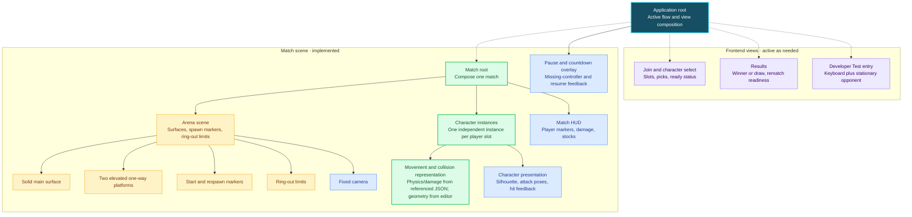
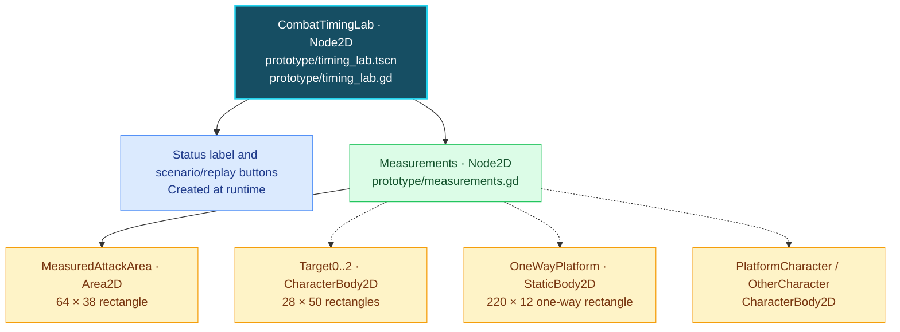

# Scene map

**Status: accepted production composition in [#8](https://github.com/Fusion2k/smash-fight/issues/8), confirmed on 2026-11-15; character content/catalog implemented in #15, shared Character movement and first Arena in #16, Match chronology/combat in #17, and application flow/HUD/stocks/presentation in #18/#19.** Zip/Bramble scenes attach `characters/character.gd`; `arenas/first_arena.tscn` contains the static topology, markers, limits and fixed camera. `match/match.tscn` composes prepared Characters and Arena with the production chronological scheduler. `app/app.tscn` is the configured main scene and owns an instance of `match/match.tscn` plus a procedurally built presentation `CanvasLayer`; `smoke/export_smoke.tscn` remains an explicit hardware probe, not the startup scene. The timing labs remain separate experimental branches; production evidence is recorded for [movement](../evidence/16-native-movement.md), [combat](../evidence/17-chronological-combat.md), [application flow](../evidence/18-application-flow.md) and [presentation](../evidence/19-character-feedback.md).

This view translates the agreed [match flow](https://github.com/Fusion2k/smash-fight/issues/4), [combat scope](https://github.com/Fusion2k/smash-fight/issues/2), and confirmed [arena direction](https://github.com/Fusion2k/smash-fight/issues/3) into an accepted scene composition. During #8 on 2026-11-15, the user accepted GDScript and the ownership split: application flow owns slots/controllers, Match owns stocks/results and simulation order, Character owns movement/combat state, and a catalog owns content validation. The [module interfaces](module-interfaces.md) record the accepted contract.

## Accepted composition

Solid lines show accepted parent/child composition. Dashed lines show phase-dependent views: the diagram does not require every menu and match view to remain loaded at once. Zip/Bramble runtime Character, Arena, Match, application flow and presentation are implemented; the separating detail is that the frontend views are built procedurally in `app/app.gd` rather than as the proposed standalone scenes.

## Accepted responsibilities

| Scene role | Requirement it must support | Implementation status |
| --- | --- | --- |
| Application/frontend | Join, independent selection, readiness, results, and Developer Test entry | Implemented in `app/app.gd` (#18); real-gamepad H1/H2/H5 evidence pending |
| Match composition | Complete restartable matches, pause, controller loss, and same-step outcomes | `match/match.tscn` / `match/match.gd` implemented in #17/#18; automated fixtures pass, physical checks pending |
| Arena | Main surface, two one-way platforms reachable by both characters' jumps, fixed view, safe starts, respawn positions, and ring-out limits | `arenas/first_arena.tscn` and `arenas/arena.gd` implemented in #16; automated reach/recovery baseline passed; human H4 remains |
| Character instance | Independent movement, damage, attack state, and airborne resources for every player slot | Zip/Bramble scenes attach shared `characters/character.gd`; native movement/resources implemented in #16; combat/action lifecycle in #17 |
| HUD/presentation | Distinguishable players, damage/stocks, attack phases, and hit feedback | Implemented in #19 in the application presentation layer; human readability/judgment pending |
| Pause/countdown presentation | Frozen match state, explicit missing-slot replacement, and three-second resume countdown | Implemented in #18 by the application-owned overlay; physical gamepad verification pending |

### Accepted scene targets

| Target | Composition and responsibility |
| --- | --- |
| `app/app.tscn` | Implemented application root (`Node2D` + `app/app.gd`). Instantiates `match/match.tscn` and builds the presentation `CanvasLayer` procedurally so it keeps processing while Match is gated off. Owns slots, controls, selection and flow. |
| Join/select/ready view | Implemented in `app/app.gd`, not as a standalone `frontend/join_select.tscn`; driven by application-owned slots. |
| Results view | Implemented in `app/app.gd`, not as a standalone `frontend/results.tscn`; winner/draw and independent rematch/reselection commands. |
| Flow overlay | Application-owned `CanvasLayer` with panels/labels built in `app/app.gd`, not as a standalone `frontend/flow_overlay.tscn`; start/resume countdown, pause and missing-controller UI keep processing while Match is frozen. |
| `match/match.tscn` | Implemented Match root (`Node2D` + `match/match.gd`); replaceable Arena instance, character container populated from slot IDs, and reads of the match view. Owns stocks, respawn scheduling, the step callback and result calculation. |
| HUD view | Built procedurally in `app/app.gd`, not as `match/match_hud.tscn`; rows come from slot IDs rather than hardcoded P1/P2 character nodes. |
| `arenas/first_arena.tscn` | StaticBody2D surfaces, two one-way platforms, Marker2D starts/respawns, editor-authored ring-out rectangle and fixed Camera2D. |
| `characters/character.gd` | Implemented shared CharacterBody2D script attached directly to both content scenes; native interval prediction/commit, movement and airborne resources. No independent gameplay physics callback or extra shared scene. |
| `characters/zip/zip.tscn`, `characters/bramble/bramble.tscn` | Implemented CharacterBody2D content scenes with shared movement, original silhouettes, SurfaceShape and Hurtboxes/Body rectangles. Same-directory character `.tres` references seven move `.tres` files and physics/damage JSON; combat lifecycle implemented in #17 and authored poses in #19. |

Developer Test uses the same Match scene with keyboard and stationary input adapters. It needs no second combat implementation or special arena. The input adapters, character catalog, hit detection and hit resolution are script modules rather than empty scene nodes. The [module interfaces](module-interfaces.md) specifies communication and state ownership; gameplay uses explicit ordered calls and presentation can subscribe to events.

[ADR 0002](../adr/0002-physics-json-and-editor-authored-geometry.md) fixes the authoring split: character physics tuning and attack damage come from JSON referenced by editor-authored character content. Geometry, attack timing, and launch direction/strength are edited in Godot. Production hit/hurt shapes must use that editor-authored source instead of duplicating dimensions in JSON. See [character authoring](character-authoring.md) for the accepted schema and reference workflow. The #11 lab's constant rectangle fixtures are experimental inputs, not a character-file schema.

## Physics backend status

[Research #12](https://github.com/Fusion2k/smash-fight/issues/12) evaluated GodotPhysics2D and Godot Rapier 2D before the timing experiment in #11. Its [cited report](https://github.com/Fusion2k/smash-fight/blob/1fb7589/docs/research/physics-backend-evaluation.md) recommends GodotPhysics2D as the initial baseline and retains Rapier v0.36.1 as a credible alternative if a relevant problem is demonstrated. During #8 on 2026-11-15, the user accepted GodotPhysics2D with explicit shape snapshots and batched hit collection. Box2D remains deferred. No project configuration change or production validation is claimed. The current `project.godot` has no custom 2D-backend selection; its Jolt setting is specifically `3d/physics_engine`.

Backend and packaging evidence informed the accepted #8 and #9 decisions. The initial GodotPhysics2D fixtures record short-window hits, query-freshness differences, one-way-platform movement, and simultaneous outcomes as described below. The user reported "prototype looks good" after reviewing the lab. Production gameplay now runs on GodotPhysics2D; other backends and target-platform verification remain outstanding.

## Implemented #11 timing lab

This hierarchy exists on [prototype/combat-timing at 3820f96](https://github.com/Fusion2k/smash-fight/tree/3820f96). Read the [experiment instructions](https://github.com/Fusion2k/smash-fight/blob/3820f96/prototype/README.md) and [measured evidence](combat-timing-evidence.md). It is separate from the accepted production composition above.

Dashed edges are fixture-dependent children. Each physics object has a `CollisionShape2D` child; the [full archived hierarchy](https://github.com/Fusion2k/smash-fight/blob/3820f96/prototype/SCENE-MAP.md) includes those shapes. Measurement code runs native physics fixtures first. The root then draws a slowed replay of recorded traces, with actual engine-frame timestamps for delayed signals. This runtime tree is intentionally small and disposable; it does not decide production scene/module responsibilities.

## Evolution checks

- Tune Zip's movement or mass: change its physics JSON, without duplicating the match scene. Change graphics-dependent geometry in the editor.
- Add Bramble: reuse the agreed combat lifecycle with different definition values and presentation.
- Select Zip twice: compose two instances with independent mutable state and player markers.
- Change the arena: keep geometry, start/respawn markers, and ring-out limits local to its content definition/scene.
- Grow to four players: compose instances from player slots; scene responsibilities must not assume exactly two hardcoded character children. Four-player content and hardware acceptance remain later work.

These are architecture evolution checks. Snapshot/same-character isolation, independent Match/combat state and both characters' recovery baselines have automated evidence; four-player composition and physical/hardware acceptance remain later work.

## #13 contact chronology extension

A separate [throwaway extension](https://github.com/Fusion2k/smash-fight/blob/f7a36da/chronology/README.md) on `prototype/contact-chronology` adds `chronology/lab.tscn` (Control), a replay UI in `chronology/lab.gd`, and a pure analytic scheduler in `chronology/model.gd`. The root temporarily creates native CharacterBody2D/StaticBody2D rectangle pairs to measure two surface boundaries, then releases them. Replay drawings are model traces, not native character motion. The original #11 tree above remains preserved.

See [contact chronology evidence](contact-chronology-evidence.md) for fifteen completed fixtures, numerical proposals and limits. Imported surface boundaries were not re-queried after changed trajectories. The accepted [production interval contract](module-interfaces.md#native-interval-contract) requires native prediction/commit agreement and fresh queries after every event; its native implementation was verified in #16/#17. The user reported "looks ok, keep going" on 2026-11-15, completing #13's human reaction. Automated visual QA remains unverified; the reaction does not establish integrated native gameplay.

## Implemented application root (#18)

`app/app.tscn` / `SmashApplication` now owns a `match/match.tscn` instance plus a presentation CanvasLayer (HUD, player markers and flow overlay). Match creates Arena and Character instances as before, retains its sole gameplay physics callback, and requests fresh app input frames on that callback. App/input own slots/controls/selection; Match owns stock/result/respawn clocks; Character owns protection/damage/action state. The earlier `smoke/export_smoke.tscn` remains an explicit hardware probe, not the main scene. [Application evidence](../evidence/18-application-flow.md) records software checks and outstanding physical gates.
