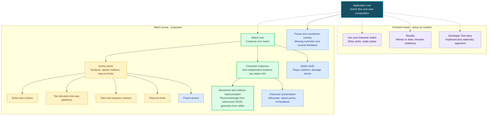
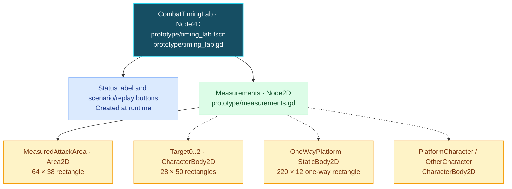

# Scene map

**Status: production composition proposed in [#8](https://github.com/Fusion2k/smash-fight/issues/8); contact-time scheduling still needs focused evidence.** The main working tree currently has no gameplay scene files or configured main scene. GDScript, GodotPhysics2D, ownership, Resource authoring, simulation timing, hit-pause rules and fixed rectangular combat geometry are accepted. Production paths below are proposed implementation targets. The implemented timing lab lives on a separate branch.

This view translates the agreed [match flow](https://github.com/Fusion2k/smash-fight/issues/4), [combat scope](https://github.com/Fusion2k/smash-fight/issues/2), and confirmed [arena direction](https://github.com/Fusion2k/smash-fight/issues/3) into a scene-composition candidate. During #8 on 2026-11-15, the user accepted GDScript and the ownership split: application flow owns slots/controllers, Match owns stocks/results and simulation order, Character owns movement/combat state, and a catalog owns content validation. The [module-interface draft](module-interfaces.md) makes this concrete; its remaining proposals are under review.

## Composition candidate

Solid lines show proposed parent/child composition. Dashed lines show phase-dependent views: the diagram does not require every menu and match view to remain loaded at once. Every node is currently proposed.

## Responsibilities to settle

| Scene role | Requirement it must support | Implementation status |
| --- | --- | --- |
| Application/frontend | Join, independent selection, readiness, results, and Developer Test entry | Proposed paths below; scenes not implemented |
| Match composition | Complete restartable matches, pause, controller loss, and same-step outcomes | Ownership accepted; concrete scene/interface under final review in #8 |
| Arena | Main surface, two one-way platforms reachable by both characters' jumps, fixed view, safe starts, respawn positions, and ring-out limits | Topology and recovery expectations agreed in #3; dimensions and scene layout pending |
| Character instance | Independent movement, damage, attack state, and airborne resources for every player slot | Authoring agreed in #7 and timing evidence completed in #11; ownership/Resources/geometry accepted in #8; concrete composition under final review |
| HUD/presentation | Distinguishable players, damage/stocks, attack phases, and hit feedback | Requirement agreed; proposed paths below |
| Pause/countdown presentation | Frozen match state, explicit missing-slot replacement, and three-second resume countdown | Behavior agreed in #4; application-owned overlay proposed below |

### Proposed concrete scenes

| Scene path | Composition and responsibility |
| --- | --- |
| `app/app.tscn` | Application root; active frontend or Match child; flow overlay in a CanvasLayer that can process while gameplay is frozen. Owns slot/controller flow. |
| `frontend/join_select.tscn` | Join/select/ready view driven by application-owned slots. |
| `frontend/results.tscn` | Winner/draw and rematch/return commands. |
| `frontend/flow_overlay.tscn` | Start/resume countdown, pause and missing-controller UI, driven by application flow. Composed by the application so it can keep processing while Match is gated off. |
| `match/match.tscn` | Match root script, replaceable Arena instance, a character container populated from slot IDs, and HUD. Owns stocks, respawn scheduling, the step callback and result calculation. |
| `match/match_hud.tscn` | Reads a match view; rows come from slot IDs rather than hardcoded P1/P2 character nodes. |
| `arenas/first_arena.tscn` | StaticBody2D surfaces, two one-way platforms, Marker2D starts/respawns, editor-authored ring-out rectangle and fixed Camera2D. |
| `characters/character.tscn` | Shared CharacterBody2D behavior, surface CollisionShape2D, editor-authored rectangular hurtboxes and visual child. No independent gameplay physics callback. |
| `characters/zip/zip.tscn`, `characters/bramble/bramble.tscn` | Character scenes based on shared character behavior, with original silhouettes, editor geometry and visuals. Corresponding CharacterDefinition and MoveDefinition Resources supply authored content. |

Developer Test uses the same Match scene with keyboard and stationary input adapters. It needs no second combat implementation or special arena. The input adapters, character catalog, hit detection and hit resolution are script modules rather than empty scene nodes. The [module-interface draft](module-interfaces.md) specifies communication and state ownership; gameplay uses explicit ordered calls and presentation can subscribe to events.

[ADR 0002](../adr/0002-physics-json-and-editor-authored-geometry.md) fixes the authoring split: character physics tuning and attack damage come from JSON referenced by editor-authored character content. Geometry, attack timing, and launch direction/strength are edited in Godot. Production hit/hurt shapes must use that editor-authored source instead of duplicating dimensions in JSON. See [character authoring](character-authoring.md) for the accepted schema and reference workflow. The #11 lab's constant rectangle fixtures are experimental inputs, not a character-file schema.

## Physics backend status

[Research #12](https://github.com/Fusion2k/smash-fight/issues/12) evaluated GodotPhysics2D and Godot Rapier 2D before the timing experiment in #11. Its [cited report](https://github.com/Fusion2k/smash-fight/blob/1fb7589/docs/research/physics-backend-evaluation.md) recommends GodotPhysics2D as the initial baseline and retains Rapier v0.36.1 as a credible alternative if a relevant problem is demonstrated. During #8 on 2026-11-15, the user accepted GodotPhysics2D with explicit shape snapshots and batched hit collection. Box2D remains deferred. No project configuration change or production validation is claimed. The current `project.godot` has no custom 2D-backend selection; its Jolt setting is specifically `3d/physics_engine`.

Backend compatibility and packaging evidence will inform #8 and #9. The initial GodotPhysics2D fixtures now record short-window hits, query-freshness differences, one-way-platform movement, and simultaneous outcomes as described below. The user reported "prototype looks good" after reviewing the lab. Production gameplay coverage, other backends, and target-platform verification remain outstanding.

## Implemented #11 timing lab

This hierarchy exists on [prototype/combat-timing at 3820f96](https://github.com/Fusion2k/smash-fight/tree/3820f96). Read the [experiment instructions](https://github.com/Fusion2k/smash-fight/blob/3820f96/prototype/README.md) and [measured evidence](combat-timing-evidence.md). It is separate from the proposed production composition above.

Dashed edges are fixture-dependent children. Each physics object has a `CollisionShape2D` child; the [full archived hierarchy](https://github.com/Fusion2k/smash-fight/blob/3820f96/prototype/SCENE-MAP.md) includes those shapes. Measurement code runs native physics fixtures first. The root then draws a slowed replay of recorded traces, with actual engine-frame timestamps for delayed signals. This runtime tree is intentionally small and disposable; it does not decide production scene/module responsibilities.

## Evolution checks

- Tune Zip's movement or mass: change its physics JSON, without duplicating the match scene. Change graphics-dependent geometry in the editor.
- Add Bramble: reuse the agreed combat lifecycle with different definition values and presentation.
- Select Zip twice: compose two instances with independent mutable state and player markers.
- Change the arena: keep geometry, start/respawn markers, and ring-out limits local to its content definition/scene.
- Grow to four players: compose instances from player slots; scene responsibilities must not assume exactly two hardcoded character children. Four-player content and hardware acceptance remain later work.

These are review questions for #8, not claims that the candidate architecture has passed them. Replace this candidate with the agreed scene tree, actual paths, and interfaces as those decisions and implementation land.

## #13 contact chronology extension

A separate [throwaway extension](https://github.com/Fusion2k/smash-fight/blob/f7a36da/chronology/README.md) on `prototype/contact-chronology` adds `chronology/lab.tscn` (Control), a replay UI in `chronology/lab.gd`, and a pure analytic scheduler in `chronology/model.gd`. The root temporarily creates native CharacterBody2D/StaticBody2D rectangle pairs to measure two surface boundaries, then releases them. Replay drawings are model traces, not native character motion. The original #11 tree above remains preserved.

See [contact chronology evidence](contact-chronology-evidence.md) for fifteen completed fixtures, numerical proposals and limits. Imported surface boundaries are not re-queried after changed trajectories; production movement/schedule design is still pending. New human feedback and visual QA remain outstanding; #11 feedback does not validate this extension.