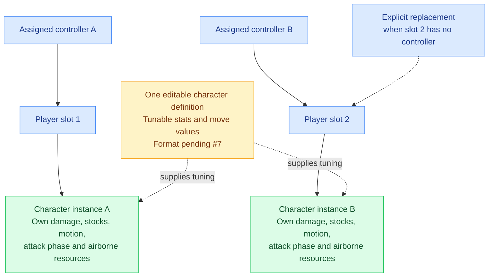

# State and content

**Status: agreed ownership constraints; exact module interfaces and data format are pending.** Sources: [planning constraints, #1](https://github.com/Fusion2k/smash-fight/issues/1), [combat, #2](https://github.com/Fusion2k/smash-fight/issues/2), [character direction, #3](https://github.com/Fusion2k/smash-fight/issues/3), and [player slots, #4](https://github.com/Fusion2k/smash-fight/issues/4).

## Same character, independent players

This diagram shows independent state, not a decision that every listed value resides in a single character script. #8 must decide which module owns stocks, outcomes, and character runtime behavior. #7 must decide how definitions are loaded, validated, and protected from accidental runtime mutation; shared versus copied definition objects remains an implementation choice.

Controller identity does not define player identity. See [ADR 0001](../adr/0001-player-slots-and-controller-assignment.md).

## Confirmed content direction

| Content | Agreed direction | Still to settle |
| --- | --- | --- |
| Zip | Small clockwork courier; light, fast, strong air movement, short reach, quick attacks, weaker individual hits | Concrete move identities and tuning |
| Bramble | Broad wooden guardian; heavy, slower, longer reach, slower attacks, stronger launches | Concrete move identities and tuning |
| Both characters | Six ordinary melee attacks and an upward recovery special; no projectiles, meters, summons, or new unique subsystems initially | Recovery differences and bounded move details in #3 |
| Arena | Floating flat main surface, two symmetric elevated one-way platforms, open surrounding space, fixed camera, ring-out limits beyond the view, opposing starts and respawns above each side | Dimensions tuned against both characters' jump/recovery reach |
| Presentation | Distinct silhouettes, player colors/markers, readable attack phases, damage/stocks, hit and launch feedback | Placeholder implementation; production art deferred |

## Ordinary change checks

| Change | Required locality | Decision still responsible |
| --- | --- | --- |
| Tune one character or attack | Its editable character definition, without changing another character | #7 |
| Run two copies of Zip | Independent mutable match state with shared character identity | #7 and #8 |
| Add Bramble | Express ordinary differences without inventing a new combat subsystem | #3, #7, and #8 |
| Change arena surfaces or ring-out layout | Arena content, rather than character-specific rules | #8 |
| Replace a disconnected gamepad | The missing slot's assignment, preserving player and match state | #4 and #8 |
| Grow from two to four slots | Player-count-aware ownership and composition | #8 and later hardware checks |

These are constraints to assess the eventual interfaces against. The architecture should hide complexity behind small interfaces that keep ordinary changes local; exact scene paths, methods, failure behavior, and verification surfaces are part of #8's deliverable.
