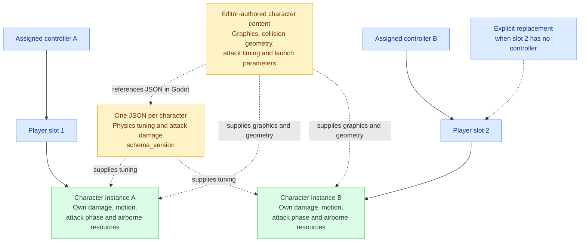

# State and content

**Status: authoring responsibilities, schema, and validation accepted in #7; ownership and implementation interfaces accepted in #8; Resources/catalog and content snapshots implemented in #15; movement/resource isolation implemented and checked in #16; full combat/gameplay isolation remains unverified.** Sources: [planning constraints, #1](https://github.com/Fusion2k/smash-fight/issues/1), [combat, #2](https://github.com/Fusion2k/smash-fight/issues/2), [character direction, #3](https://github.com/Fusion2k/smash-fight/issues/3), [player slots, #4](https://github.com/Fusion2k/smash-fight/issues/4), and [character authoring, #7](https://github.com/Fusion2k/smash-fight/issues/7).

## Same character, independent players

Match owns stocks by slot; Character owns damage, motion and action state. This diagram shows independent state, not a decision that every listed value resides in a single character script. #7 fixes fresh validated tuning snapshots at match/test restart and independent mutable instance state. #8 assigns slots/controllers to Application, stocks/outcomes to Match, movement/combat state to Character, and loading/validation to the catalog. Prepared definitions are read-only with mutable shape data copied; every Character receives fresh runtime state. See [module interfaces](module-interfaces.md) for the accepted Resource and interval contracts.

## Authoring responsibilities

The user clarified that JSON contains character physics tuning **and per-attack damage**. Hitboxes, hurtboxes, dimensions, offsets, attack timing, and attack launch direction/strength are authored in Godot's editor. The editor-authored character content references its JSON while working in Godot. See [ADR 0002](../adr/0002-physics-json-and-editor-authored-geometry.md) and the [accepted authoring specification](character-authoring.md). The JSON and editor-authored content own different data, without duplicating geometry or attack values between them.

JSON edits apply when starting the next match or restarting Developer Test. Invalid characters are unavailable with clear file/field errors rather than silent fallback stats. First-playable tuning happens in the source checkout; exported-game modding and live match reload are deferred. Physics uses world units/second and world units/second squared, with positive relative mass. The accepted #7 contract requires all fields and seven damage entries, rejects unknown fields/invalid values/unsupported versions, and keeps mutable instance state separate from stable match settings.

Controller identity does not define player identity. See [ADR 0001](../adr/0001-player-slots-and-controller-assignment.md).

## Confirmed content direction

| Content | Agreed direction | Still to settle |
| --- | --- | --- |
| Zip | Small clockwork courier; light, fast, strong air movement, short reach, quick attacks, weaker individual hits; taller spring-boost recovery | Numeric tuning and implementation |
| Bramble | Broad wooden guardian; heavy, slower, longer reach, slower attacks, stronger launches; shorter recovery leap with stronger contact hit | Numeric tuning and implementation |
| Both characters | Agreed melee move kits below; shared attack lifecycle, with no projectiles, meters, summons, lingering hazards, multi-hit attacks, or new unique subsystems initially | Data schema in #7 and scene/module responsibilities in #8 |
| Arena | Floating flat main surface, two symmetric elevated one-way platforms, open surrounding space, fixed camera, ring-out limits beyond the view, opposing starts and respawns above each side | Dimensions tuned against both characters' jump/recovery reach |
| Presentation | Distinct silhouettes, player colors/markers, readable attack phases, damage/stocks, hit and launch feedback | Placeholder implementation; production art deferred |

### Agreed move identities

| Attack | Zip | Bramble |
| --- | --- | --- |
| Ground neutral | Quick forward wrench jab | Broad forward branch swing |
| Ground up | Overhead wrench flick | Branch uppercut |
| Ground down | Short low sweep | Wide root sweep |
| Aerial neutral | Quick forward swipe | Broad forward sweep |
| Aerial up | Overhead wrench tap | Heavy overhead swing |
| Aerial down | Small downward stomp | Heavy downward stomp |
| Recovery special | Upward spring boost | Upward root-powered leap |

Differences use timing, reach, damage, launch strength, and recovery movement within the shared lifecycle. Both characters must reach elevated platforms using their jumps and recover from modest positions below/beside the stage when their air jump and recovery special remain available. Deep falls stay unrecoverable. Platform heights and recovery distances remain provisional tuning targets, not passed playtest checks.

## Ordinary change checks

| Change | Required locality | Decision still responsible |
| --- | --- | --- |
| Tune character movement or mass | Its physics JSON, without changing another character | #7 |
| Change hit/hurt geometry, sizes, or offsets | Editor-authored character content alongside graphics | #7 and #8 |
| Tune attack damage | The character's JSON, keyed by the shared move IDs | #7 |
| Tune attack timing or launch direction/strength | Editor-authored move data alongside animation | #7 and #8 |
| Run two copies of Zip | Independent mutable match state with shared character identity | #7 and #8 |
| Add Bramble | Express ordinary differences without inventing a new combat subsystem | #3, #7, and #8 |
| Change arena surfaces or ring-out layout | Arena content, rather than character-specific rules | #8 |
| Replace a disconnected gamepad | The missing slot's assignment, preserving player and match state | #4 and #8 |
| Grow from two to four slots | Player-count-aware ownership and composition | #8 and later hardware checks |

These constraints are addressed by the accepted [module interfaces](module-interfaces.md) and [scene map](scene-map.md). #15 verifies tuning locality, fresh snapshots, defensive containers, and native shape isolation through the catalog interface. #16 adds independent movement/resources for four native Character bodies. Complete A2 action/history and local-pause lifecycle behavior remains #17.
