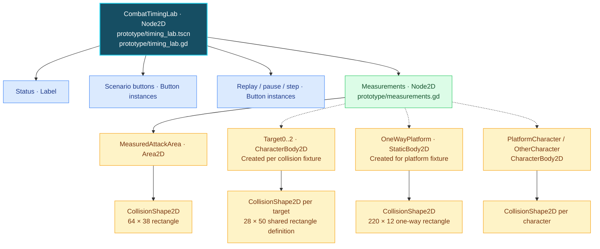

# Implemented experiment scene map

This is the actual scene composition of the throwaway #11 lab. It is separate from the proposed production scene tree in the main architecture documents.

Solid edges show parent/child composition; dashed edges indicate fixture-dependent children. Scripts create the controls and physics fixtures at runtime. The root draws the replay from measured traces, not from those fixtures' current post-measurement positions. Shape resources are constant definitions; target bodies and measurement ledgers are separate runtime state.

The experiment deliberately uses two scripts without defining production gameplay interfaces. Its fixtures and UI should remain disposable. The next architecture decision uses the observed timing behavior to select real module responsibilities and interfaces.
